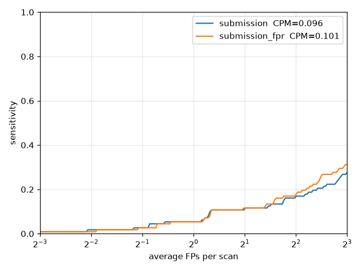
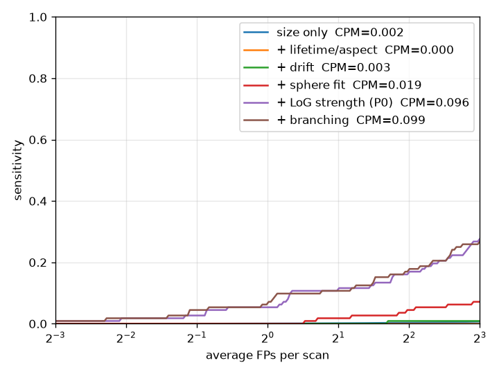

# Lung Nodule Detection in CT: P0, a classical 2D pipeline with slice tracking

This is the code for **P0**, the main method in *Case Study 2: Lung Nodule Detection in CT Images* (VJTI, Electronics Engineering, 2026–27; Gargi Gupta and Sarayu Anantharaman; guide Prof. G. M. Galshetwar). The report is in `Case_Study_2_Lung_Nodule_Report_v6.pdf`.

P0 uses **no machine learning**. Every step is a fixed algorithm or a hand-set rule, and every step works on 2D slices. Depth information comes from tracking blobs from slice to slice, the way objects are tracked across video frames:

- A **nodule** (a sphere) appears, widens and disappears within a few slices, and stays in place.
- A **vessel** (a tube) lasts many slices, keeps the same width, and drifts sideways.
- **Ribs** lie outside the lung mask, so they never become candidates.

P1 (the V-JEPA2 benchmark) is not implemented yet.

---

## Contents
1. [Pipeline](#1-pipeline)
2. [Results on LUNA16 subset0](#2-results-on-luna16-subset0)
3. [Where every parameter comes from](#3-where-every-parameter-comes-from)
4. [Changes from the report and why](#4-changes-from-the-report-and-why)
5. [Setup](#5-setup)
6. [Data](#6-data)
7. [Running](#7-running)
8. [Project layout](#8-project-layout)
9. [Known limitations and next steps](#9-known-limitations-and-next-steps)

---

## 1. Pipeline

| Step | Report § | Module | What it does |
|---|---|---|---|
| 01 Preprocessing | 8.1 | `preprocess.py` | Clip HU to [−1000, 400], rescale to [0, 1], 3×3 median filter per slice. Spacing is kept, so all sizes are in mm. No histogram equalisation. |
| 02 Lung segmentation | 8.2 | `lung_mask.py` | Threshold at −400 HU → remove components touching the image border → remove the trachea → keep the 2 largest components → fill holes → 10 mm rolling-ball closing per lung. **Ribs are removed here.** |
| 03 Candidate detection | 8.3 | `candidates.py` | Multi-scale σ²-normalised LoG inside the lung (r = 1.5–15 mm, σ = r/√2) → local maxima → region growing (> −600 HU) → per-blob features (size, circularity, eccentricity, HU, distance to the lung wall). |
| 04 Slice tracking | 8.4 | `tracking.py` | Hungarian matching of blobs between consecutive slices. Gate = max(3 mm, 0.5·r); a gap of one slice is allowed. Each track is one 3D candidate. |
| 05 Feature extraction | 8.5 | `features.py` | Per track: lifetime, aspect, drift ratio, sphere-profile fit against a tube fit, branching. **Vessels are removed using these features.** |
| 06 Classification | 8.6 | `classify.py` | Score = product of soft rules, in [0, 1]. Each rejected track gets a readable reason, e.g. `rejected: lifetime 66.2 mm, aspect 18.3 (> 2.5), centre shifts 16.5 x radius (> 1), poor sphere fit`. |
| Evaluation | 11 | `evaluation.py` | FROC, CPM, bootstrap 95% CI over scans, candidate recall. |

**Classification rules (step 06)**

| Rule | Formula | Rejects |
|---|---|---|
| s_aspect | sigmoid((2.5 − lifetime/diameter) / 0.3) | Long vessels running along z |
| s_drift | sigmoid((1.0 − lateral shift/radius) / 0.2) | Slanted vessels |
| s_sphere | sigmoid(sphere_gain / 0.05), or 0.5 if the track has fewer than 3 slices | Constant-width tubes |
| s_size | 1 if 3 mm ≤ diameter ≤ 30 mm, else 0 | Noise and large structures |
| s_min_slices | 1 if the track spans ≥ 2 slices, else 0 | Single-slice noise |
| s_log | min(peak LoG response / (2/e), 1) | Weak, low-contrast blobs |
| s_branch (off by default) | exp(−0.5 · branches) | Vessel junctions |

---

## 2. Results on LUNA16 subset0

89 scans, 112 nodules. Scored with this repo's re-implementation of the LUNA16 matching rules (see §9). The 95% CIs come from 1,000 bootstrap resamples over scans.

| Version | Detection CPM | FP-reduction CPM | Sens. @ 1 FP/scan | Sens. @ 8 FP/scan |
|---|---|---|---|---|
| v1: report parameters as written | 0.036 (0.014–0.062) | 0.085 (0.056–0.125) | 0.027 | 0.089 |
| **v2: current** (drift ratio + LoG strength, §4) | **0.096 (0.061–0.135)** | **0.101 (0.068–0.143)** | **0.054** | **0.277** |

| Other numbers (v2) | |
|---|---|
| **Candidate recall** (nodules hit by any track, any score) | **97.3%**; for comparison, ETROCAD in LUNA16 reached 92.9% |
| Max sensitivity among scored tracks (score > 0) | 93.8% |
| Tracks per scan | ~4,300 (~1,100 with score > 0) |
| Run time | 48 s/scan on an Apple M1 Max, 1 core per scan (6 scans in parallel): preprocessing 6 s, lung mask 8 s, candidates 30 s, tracking + features + rules 4 s |

**Ablation** (report §11.2: rules added one at a time, v2)

| Rules | CPM | @0.125 | @0.25 | @0.5 | @1 | @2 | @4 | @8 |
|---|---|---|---|---|---|---|---|---|
| size only | 0.002 | 0.000 | 0.000 | 0.000 | 0.001 | 0.002 | 0.003 | 0.007 |
| + lifetime/aspect | 0.000 | 0.000 | 0.000 | 0.000 | 0.000 | 0.000 | 0.000 | 0.000 |
| + drift | 0.003 | 0.000 | 0.000 | 0.000 | 0.000 | 0.000 | 0.009 | 0.009 |
| + sphere fit | 0.019 | 0.000 | 0.000 | 0.000 | 0.000 | 0.018 | 0.045 | 0.071 |
| **+ LoG strength (P0)** | **0.096** | 0.009 | 0.018 | 0.027 | 0.054 | 0.116 | 0.170 | 0.277 |
| + branching | 0.099 | 0.009 | 0.018 | 0.045 | 0.071 | 0.107 | 0.179 | 0.268 |

<p align="center">
 
</p>

**What the results show**

- **Steps 01–04 work.** 97.3% of nodules end up as a track, and the lung mask keeps ribs out. Candidate generation is not the bottleneck.
- **Step 06 is the bottleneck.** With about 4,300 tracks per scan, the rules must rank a nodule in the top 1–2 tracks of its scan to score well at low FP rates.
- **Size and aspect barely move the CPM on their own.** Most false positives are short, round cross-sections of small vessels, and these pass both rules. Their scores tie at 1.0, so these rules can filter but cannot rank.
- **The sphere fit is the strongest shape rule, but it is weak on real data.** The median `sphere_gain` for real nodules is only 0.07, and 27% of nodules fit a tube better than a sphere. Real nodules are not perfect spheres, and thick slices give few points to fit.
- **LoG strength gives the biggest gain (0.019 → 0.096).** It is the detector's own confidence and gives a continuous ranking.
- **Branching adds nothing significant** (0.099 against 0.096, well inside the CI), so it stays off.
- **These numbers are in the range of the 2D classical systems in the report's survey,** and well below deep learning (CPM 0.93–0.95). The report expected this (§12).

**Example: the report's scan …456733 (Figure 1)**


Cyan: lung mask. Orange: LoG blobs. Yellow dashed: the annotated 12.7 mm nodule. On slice 33 the nodule touches a large hazy structure. In v1, region growing leaked into it, which moved the blob centroid and made the nodule look like it drifted 2.9 mm/slice: it ranked **423rd** in its scan. Taking the blob centre from the LoG peak (§4) fixed this, and the nodule now ranks **22nd**.

---

## 3. Where every parameter comes from

Our guide's feedback was that parameters must come from research or theory, not from trial and error on the data. **No parameter in P0 was fitted to LUNA16.**

| Parameter | Value | Source |
|---|---|---|
| HU clip | [−1000, 400] | HU physics: covers air to soft tissue and stops bone dominating (report §3.1) |
| Median filter | 3×3 | Removes speckle while keeping edges (report §8.1) |
| Lung threshold | −400 HU | Separates air/lung from tissue; classical lung segmentation [4, 5, 15] |
| Rolling-ball closing | 10 mm | Armato et al. [5, 6]; Gu et al. use 15 mm [15] |
| **LoG σ** | **σ = r/√2** | **Lindeberg [11].** For a disc of radius r, the σ²-normalised LoG at the centre is −(r²/σ²)·e^(−r²/2σ²), which peaks at r² = 2σ². Checked numerically: the best σ is within 1% of r/√2 for r = 3–15 px. |
| LoG radii | 1.5–15 mm | Nodule size range 3–30 mm (LUNA16/LIDC definition [7]) |
| Region growing | −600 HU | Solid-nodule boundary (report §8.3) |
| Region clip | 1.5 × LoG radius | The LoG scale estimates the blob radius [11]; 1.5× allows 50% error before cutting off a leak |
| Sub-pixel peak | quadratic fit | Standard scale-space peak refinement (Lowe, SIFT, IJCV 2004) |
| Tracking gate | max(3 mm, 0.5·r) | Report §8.4 |
| Gap | 1 slice | Report §8.4 |
| Aspect threshold | 2.5 | Report §8.5–8.6: a sphere has aspect ≈ 1, a vessel much more |
| **Drift ratio threshold** | **1.0** | **Geometry.** A sphere's centre does not move. If the centre moves by more than the object's radius, the first and last cross-sections no longer contain each other's centre, so the object is not a ball. |
| Sigmoid softness | 0.2 × threshold (drift); 0.3 (aspect) | Same softness-to-threshold ratio the report uses (0.1/0.5 = 0.2) |
| Sphere radius bound | R ≤ 1.3·√(r_max² + (dz/2)²) | Geometry: the equator can fall between two slices. Without a bound, a huge sphere fits a tube perfectly. |
| Sphere neutral score | 0.5 | Tracks with fewer than 3 slices cannot be fitted (report §8.5) |
| **LoG strength normaliser** | **2/e ≈ 0.736** | **Lindeberg [11]:** the maximum σ²-normalised LoG response of a unit-contrast disc (same derivation as σ = r/√2). Checked numerically: 0.730–0.736. |
| Size range | 3–30 mm | LUNA16/LIDC nodule definition [7] |
| Min lifetime | 2 slices | Report §9 (noise blobs) |

All values are in `configs/p0.yaml` and commented in `src/lungnod/config.py`.

---

## 4. Changes from the report and why

Each change came from looking at a failure on real data, not from searching for better numbers.

| Change | Why |
|---|---|
| **Blob centre = LoG peak with sub-pixel refinement**, and the region-growing area is clipped to 1.5 × LoG radius | Region growing leaks into attached vessels and opacities (the report's own known weakness, §12). The leak moved centroids and created false "drift", e.g. Figure 1's nodule went from rank 423 to rank 22. |
| **Drift = line-fit lateral shift / radius, threshold 1** (the report used mean shift in mm/slice, threshold 0.5) | 1. Subset0 has slices from 0.5 to 2.5 mm thick, so "0.5 mm per slice" allows different vessel angles in different scans (about 11° at 2.5 mm, about 45° at 0.5 mm). 2. Real nodules had a median per-slice drift of 0.62 mm, so the old rule was the main reason for rejecting 73 of 109 detected nodules. With the new rule, drift is the main reason for only 12. The old value is still saved as `drift_mm_per_slice`. |
| **New rule: LoG strength** | It gives a continuous ranking among the many round, short false positives that tie on the shape rules. Its normaliser comes from theory (2/e). **Trade-off:** it uses contrast, while the report said P0 uses only shape. A nodule with very low contrast against its surroundings will score lower. |
| **Lung mask:** 3D removal of small air components, and closing done per lung | Removes bowel gas below the diaphragm, and stops the 10 mm closing from joining the two lungs. |
| **LoG input:** outside-lung pixels set to air | Removes strong false responses at the chest wall. |
| **Sphere fit:** R bounded | Without the bound, a large sphere fits a tube perfectly and the feature is useless. |
| **Branching:** computed but off by default | Matches the report's s1–s4 formula; the ablation shows no significant gain. |

---

## 5. Setup

Requires Python ≥ 3.10. Uses NumPy, SciPy, scikit-image, SimpleITK, pandas and matplotlib.

```bash
uv venv --python 3.12 .venv
uv pip install -e ".[dev]" --python .venv/bin/python
source .venv/bin/activate

pytest                            # 10 tests: unit tests + an end-to-end synthetic phantom
python scripts/demo_synthetic.py  # runs P0 on the phantom, no data needed
```

`src/lungnod/synthetic.py` builds a phantom chest: body, two lungs, ribs, an 8 mm and a 6 mm nodule, and a straight and a slanted vessel. Nodules and vessels have the same HU, so only shape across slices can separate them. P0 accepts both nodules and rejects both vessels and all ribs.

---

## 6. Data

**LUNA16** (888 CT scans from LIDC-IDRI, CC BY 4.0) is on Zenodo in two parts:
- Part 1: https://zenodo.org/records/3723295 (subsets 0–6, annotations, candidates, evaluation script, lung masks)
- Part 2: https://zenodo.org/records/4121926 (subsets 7–9)

```bash
python scripts/download_luna16.py --subsets 0        # CSVs + subset0 (~7 GB)
python scripts/download_luna16.py                    # everything (~67 GB zipped)
python scripts/download_luna16.py --subsets 2 3 4 &  # several processes in parallel:
python scripts/download_luna16.py --subsets 5 6 7 &  # Zenodo limits each connection to ~3–4 MB/s
```

The script checks the MD5 of every file against Zenodo, extracts it, deletes the zip, and resumes after a dropped connection. Run it again to continue; finished files are skipped. The result:

```
data/luna16/
  subset0/ … subset9/        *.mhd + *.raw (one scan per pair)
  annotations.csv            1,186 nodules (≥ 3 mm, accepted by ≥ 3 of 4 radiologists)
  annotations_excluded.csv   irrelevant findings, ignored when scoring
  candidates_V2.csv          official candidate list (FP-reduction track)
  evaluationScript/          official LUNA16 evaluation script
  seg-lungs-LUNA16/          reference lung masks
```

**LNDb** (external test set, report §7.2) requires registration and is not downloaded yet.

---

## 7. Running

```bash
# 1. Inspect one scan: figures for every step + the track table with explanations
python scripts/inspect_scan.py --mhd data/luna16/subset0/<uid>.mhd \
    --annotations data/luna16/annotations.csv --out outputs/inspect

# 2. Run P0 on one or more subsets (detection track, plus the FPR track via --candidates)
python scripts/run_p0.py --data-root data/luna16 --subsets 0 --out outputs/p0_s0 \
    --candidates data/luna16/candidates_V2.csv --workers 6

# 3. FROC / CPM with a bootstrap CI
python scripts/evaluate.py --run outputs/p0_s0 --annotations data/luna16/annotations.csv \
    --excluded data/luna16/annotations_excluded.csv --bootstrap 1000

# 4. Ablation: rescores tracks.csv, no need to rerun detection
python scripts/ablation.py --run outputs/p0_s0 --annotations data/luna16/annotations.csv \
    --excluded data/luna16/annotations_excluded.csv
```

To change a parameter, copy `configs/p0.yaml`, edit it, and pass `--config my.yaml`.

**Outputs of `run_p0.py`**

| File | Contents |
|---|---|
| `tracks.csv` | One row per track: world and voxel centre, all features, every rule score, probability, explanation |
| `submission.csv` | LUNA16 detection format: `seriesuid, coordX, coordY, coordZ, probability` |
| `submission_fpr.csv` | Score of every `candidates_V2` entry (the track passing through it, or 0) |
| `config.yaml`, `timings.csv`, `seriesuids.txt` | For reproducibility |
| `metrics.json`, `froc.png` | From `evaluate.py` |
| `ablation.csv`, `ablation_froc.png` | From `ablation.py` |

---

## 8. Project layout

```
src/lungnod/
  config.py       every parameter, with its source
  io.py           MetaImage loading, world <-> voxel coordinates
  preprocess.py   step 01
  lung_mask.py    step 02
  candidates.py   step 03
  tracking.py     step 04
  features.py     step 05
  classify.py     step 06
  pipeline.py     steps 01-06 for one scan + FPR-track scoring
  batch.py        many scans in parallel
  evaluation.py   FROC / CPM / bootstrap / candidate recall
  viz.py          figures
  synthetic.py    phantom for tests
scripts/          download, run, evaluate, ablation, inspect, demo
tests/            unit tests + phantom end-to-end test
configs/p0.yaml   default parameters
docs/figures/     figures used in this README
```

---

## 9. Known limitations and next steps

**Limitations**
- **Scoring.** The rules rank poorly among about 4,300 tracks per scan; this is the main gap to published classical systems, which all use a trained classifier at this step (report §4.3).
- **Sphere fit is weak on real nodules.** They are irregular, and thick slices give 2–4 points to fit.
- **Nodules attached to vessels** can merge into one long track (report §12).
- **Ground-glass nodules** fall below the −600 HU region-growing threshold. For the report's stretch goal, set `candidates.fallback_disc: true`.
- **Evaluation code.** `evaluation.py` re-implements the official LUNA16 matching rules. Final reported numbers should come from the official script in `data/luna16/evaluationScript/`.
- **Results so far are on subset0 only** (89 of 888 scans).

**Next steps**
1. **FP breakdown** (report §11.2): label about 100 top-scoring FPs as vessel, rib, wall or other, to see what fools the rules.
2. **All 10 subsets:** run P0 on 888 scans for the full CPM with CI. This takes about 2 hours with 6 workers.
3. **Added-noise experiment** (low-dose-like images) and **LNDb** external test.
4. **P1:** V-JEPA2 with an attentive probe, scoring the same candidates (`tracks.csv`) so the comparison with P0 is fair.

---

*References in brackets [n] refer to the report's reference list.*
