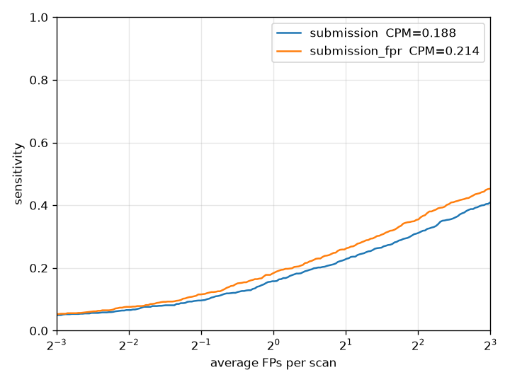
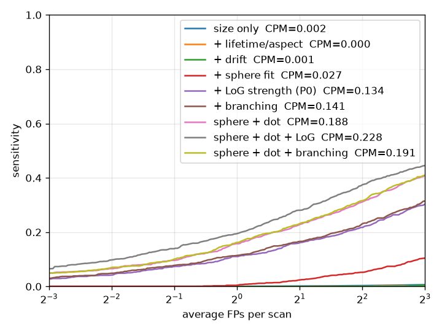
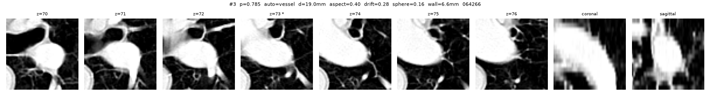
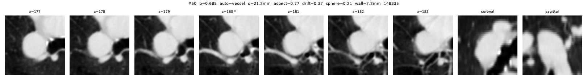
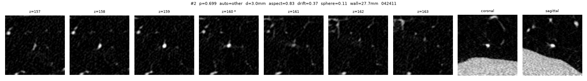
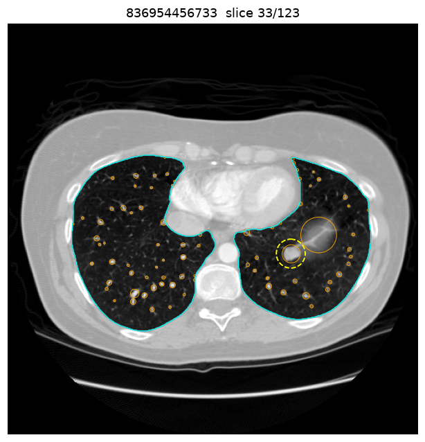
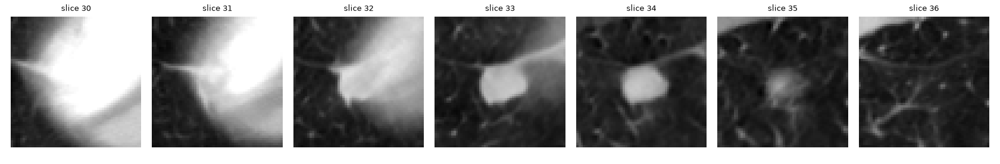

# Lung Nodule Detection in CT: P0, a classical 2D pipeline with slice tracking

This is the code for **P0**, the main method in *Case Study 2: Lung Nodule Detection in CT Images* (VJTI, Electronics Engineering, 2026–27; Gargi Gupta and Sarayu Anantharaman; guide Prof. G. M. Galshetwar). The report is in `Case_Study_2_Lung_Nodule_Report_v6.pdf`.

P0 uses **no machine learning**. Every step is a fixed algorithm or a hand-set rule, and every step works on 2D slices. Depth information comes from tracking blobs from slice to slice, the way objects are tracked across video frames:

- A **nodule** (a sphere) appears, widens and disappears within a few slices, and stays in place.
- A **vessel** (a tube) lasts many slices, keeps the same width, and drifts sideways.
- **Ribs** lie outside the lung mask, so they never become candidates.

P1 (the V-JEPA2 benchmark) is not implemented yet.

---

## Contents
1. [Pipeline](#1-pipeline)
2. [Results on LUNA16](#2-results-on-luna16)
3. [Where every parameter comes from](#3-where-every-parameter-comes-from)
4. [Changes from the report and why](#4-changes-from-the-report-and-why)
5. [Setup](#5-setup)
6. [Data](#6-data)
7. [Running](#7-running)
8. [Project layout](#8-project-layout)
9. [Known limitations and next steps](#9-known-limitations-and-next-steps)

---

## 1. Pipeline

| Step | Report § | Module | What it does |
|---|---|---|---|
| 01 Preprocessing | 8.1 | `preprocess.py` | Clip HU to [−1000, 400], rescale to [0, 1], 3×3 median filter per slice. Spacing is kept, so all sizes are in mm. No histogram equalisation. |
| 02 Lung segmentation | 8.2 | `lung_mask.py` | Threshold at −400 HU → remove components touching the image border → remove the trachea → keep the 2 largest components → fill holes → 10 mm rolling-ball closing per lung. **Ribs are removed here.** |
| 03 Candidate detection | 8.3 | `candidates.py` | Multi-scale σ²-normalised LoG inside the lung (r = 1.5–15 mm, σ = r/√2) → local maxima → region growing (> −600 HU) → per-blob features (size, circularity, eccentricity, HU, distance to the lung wall). |
| 04 Slice tracking | 8.4 | `tracking.py` | Hungarian matching of blobs between consecutive slices. Gate = max(3 mm, 0.5·r); a gap of one slice is allowed. Each track is one 3D candidate. |
| 05 Feature extraction | 8.5 | `features.py` | Per track: lifetime, aspect, drift ratio, sphere-profile fit against a tube fit, branching. **Vessels are removed using these features.** |
| 06 Classification | 8.6 | `classify.py` | Score = product of soft rules, in [0, 1]. Each rejected track gets a readable reason, e.g. `rejected: lifetime 66.2 mm, aspect 18.3 (> 2.5), centre shifts 16.5 x radius (> 1), poor sphere fit`. |
| Evaluation | 11 | `evaluation.py`, `scripts/official_eval.py` | FROC, CPM, bootstrap 95% CI over scans, candidate recall. `official_eval.py` runs the official LUNA16 script; the two agree exactly. |

**Classification rules (step 06)**

| Rule | Formula | Rejects |
|---|---|---|
| s_aspect | sigmoid((2.5 − lifetime/diameter) / 0.3) | Long vessels running along z |
| s_drift | sigmoid((1.0 − lateral shift/radius) / 0.2) | Slanted vessels |
| s_sphere | sigmoid(sphere_gain / 0.05), or 0.5 if the track has fewer than 3 slices | Constant-width tubes |
| s_size | 1 if 3 mm ≤ diameter ≤ 30 mm, else 0 | Noise and large structures |
| s_min_slices | 1 if the track spans ≥ 2 slices, else 0 | Single-slice noise |
| s_dot | sigmoid((2.5 − in-plane aspect) / 0.3), in-plane aspect = √(3/q − 2), q = \|λ_small\|/\|λ_large\| of the 2D Hessian at the blob's LoG peak and scale (median over the track's slices) | Vessels lying in the slice plane (Li, Sone & Doi [9]) |
| s_log (off by default) | min(peak LoG response / (2/e), 1) | Weak, low-contrast blobs (uses contrast, not shape) |
| s_branch (off by default) | exp(−0.5 · branches) | Vessel junctions |

All default rules use shape only; none uses brightness.

---

## 2. Results on LUNA16

**All 888 scans** (10 official subsets, 1,186 nodules). Scores were checked with the **official LUNA16 evaluation script** (`scripts/official_eval.py`). It gives the same values as this repo's `evaluation.py` at all 7 FP rates, on both tracks. The 95% CIs come from 1,000 bootstrap resamples over scans.

**Main result**

| Track | CPM (95% CI) | @0.125 | @0.25 | @0.5 | @1 | @2 | @4 | @8 |
|---|---|---|---|---|---|---|---|---|
| **Nodule detection** (P0 end to end) | **0.188 (0.171–0.206)** | 0.049 | 0.066 | 0.096 | 0.158 | 0.228 | 0.312 | 0.410 |
| **FP reduction** (P0 scores `candidates_V2`) | **0.214 (0.196–0.232)** | 0.052 | 0.076 | 0.116 | 0.185 | 0.260 | 0.355 | 0.453 |

Previous version (LoG strength instead of the Hessian dot rule): detection 0.134 (0.119–0.151), FP reduction 0.146 (0.131–0.163). The CIs do not overlap.

| Other numbers | |
|---|---|
| **Candidate recall** (nodules hit by any P0 track, any score) | **94.4%**; for comparison, ETROCAD in LUNA16 reached 92.9% |
| Max sensitivity among scored tracks (score > 0) | 90.6% |
| Tracks per scan | ~4,300 (~1,100 with score > 0) |
| Run time | ~69 s/scan on an Apple M1 Max, 1 core per scan (46 s before the Hessian was added: the candidate step now computes 3 second-derivative images per scale instead of 2). All 888 scans take ~3 h with 8 in parallel. |

**Per subset** (the 10 official folds). P0 has no trained parts, so each subset is simply scored on its own.

| Subset | 0 | 1 | 2 | 3 | 4 | 5 | 6 | 7 | 8 | 9 | **mean ± sd** |
|---|---|---|---|---|---|---|---|---|---|---|---|
| Nodules | 112 | 128 | 128 | 119 | 128 | 108 | 129 | 111 | 118 | 105 | |
| Detection CPM | 0.162 | 0.181 | 0.224 | 0.186 | 0.182 | 0.181 | 0.235 | 0.180 | 0.176 | 0.173 | **0.188 ± 0.023** |
| Detection CPM, previous version | 0.096 | 0.176 | 0.180 | 0.163 | 0.112 | 0.126 | 0.143 | 0.135 | 0.100 | 0.105 | 0.134 ± 0.031 |
| Candidate recall | 0.973 | 0.961 | 0.961 | 0.916 | 0.938 | 0.926 | 0.969 | 0.910 | 0.924 | 0.952 | 0.943 |

Subset0 was used to debug the pipeline (§4). It is one of the weaker subsets, so those fixes did not inflate the overall result. The dot rule improved every one of the 10 subsets.

**Development history** (subset0 only, detection track)

| Version | Detection CPM | FP-reduction CPM |
|---|---|---|
| v1: report parameters as written | 0.036 (0.014–0.062) | 0.085 (0.056–0.125) |
| v2: blob centre from LoG peak, drift ratio, LoG strength (§4) | 0.096 (0.061–0.135) | 0.101 (0.068–0.143) |
| v3: current (Hessian dot rule replaces LoG strength; §4) | 0.162 | – |

**Ablation** (report §11.2: rules added one at a time, all 888 scans, detection track)

| Rules | CPM | @0.125 | @0.25 | @0.5 | @1 | @2 | @4 | @8 |
|---|---|---|---|---|---|---|---|---|
| size only | 0.002 | 0.000 | 0.000 | 0.000 | 0.001 | 0.002 | 0.003 | 0.007 |
| + lifetime/aspect | 0.000 | 0.000 | 0.000 | 0.000 | 0.000 | 0.000 | 0.001 | 0.003 |
| + drift | 0.001 | 0.000 | 0.000 | 0.000 | 0.000 | 0.000 | 0.001 | 0.004 |
| + sphere fit | 0.027 | 0.001 | 0.001 | 0.001 | 0.004 | 0.024 | 0.052 | 0.105 |
| + LoG strength (v2) | 0.134 | 0.028 | 0.042 | 0.073 | 0.110 | 0.162 | 0.218 | 0.304 |
| + LoG strength + branching | 0.141 | 0.030 | 0.049 | 0.078 | 0.115 | 0.166 | 0.232 | 0.315 |
| **+ dot (P0, shape only)** | **0.188** | 0.049 | 0.066 | 0.096 | 0.158 | 0.228 | 0.312 | 0.410 |
| + dot + branching | 0.191 | 0.050 | 0.070 | 0.101 | 0.162 | 0.232 | 0.315 | 0.410 |
| + dot + LoG strength | 0.228 | 0.065 | 0.098 | 0.140 | 0.196 | 0.281 | 0.374 | 0.445 |

Rows from "+ LoG strength" down each add to "+ sphere fit".

<p align="center">
 
</p>

**False-positive breakdown** (report §11.2: the 100 highest-scoring FPs across all 888 scans, **v2 rules**, i.e. before the dot rule; `scripts/fp_breakdown.py`)

The labels below come from rules of thumb on the features and still need checking by hand in `outputs/p0_all/fp_breakdown/fp_labels.csv` (v2 run; regenerate with `fp_breakdown.py --run outputs/p0_all_v3` for the current rules).

| Provisional type | Count | Median diameter | Median aspect | Median wall distance |
|---|---|---|---|---|
| Vessel | 91 | 13.3 mm | 0.72 | 6.3 mm |
| Other (small round blobs) | 7 | 3.6 mm | 1.05 | 14.2 mm |
| Wall | 2 | 6.8 mm | 0.52 | 2.5 mm |
| Rib | 0 | – | – | – |





*Each sheet shows 7 axial slices through the FP, then coronal and sagittal views. Top two: large hilar vessels. They are long tubes in the coronal view, but because they run mostly within the slice plane and are 19–21 mm wide, they cross only ~5 axial slices, so aspect = lifetime/diameter is 0.4–0.8 and they look "round". Bottom: a small vessel cross-section that is very hard to tell from a 3 mm nodule.*

**What the results show**

- **Ribs are solved.** None of the top 100 FPs is a rib: the lung mask removes them, as designed (report §8.2, §9).
- **Candidate generation works.** 94.4% of nodules become a track, above the classical candidate detectors in the report's survey. It is not the bottleneck.
- **Scoring is the bottleneck.** With ~4,300 tracks per scan, a nodule must rank in the top 1–2 tracks of its scan to count at low FP rates.
- **Size, aspect and drift filter but cannot rank.** Most FPs are short, round cross-sections that pass these rules, so their scores tie at 1.0 and the three rules together give CPM ≈ 0.
- **The sphere fit is the strongest shape rule, but weak on real data.** Over all 888 scans, the median `sphere_gain` for real nodules is only 0.09, and 21% of them fit a tube better than a sphere. Real nodules are irregular, and thick slices give few points to fit.
- **In v2 the main FP source was large hilar vessels.** The aspect rule assumes vessels run along z. A wide vessel running within the slice plane breaks that assumption, and its strong LoG response (median 0.55, against 0.38 for real nodules) pushed it up the ranking. LoG responds to a line at about 2/3 of its response to a disc, so LoG alone cannot reject it.
- **The Hessian dot rule fixes most of this (0.027 → 0.188).** It splits the LoG into its two curvatures and uses their ratio, which ignores contrast. On subset0, the v2 top-100 FPs had median q = 0.41 against 0.65 for nodules; 40% of those FPs had in-plane aspect > 2.5, against 9% of nodules. It beats LoG strength (0.134) while using shape only.
- **Adding LoG strength on top of the dot rule gives 0.228**, the best score, but it brings back the contrast dependence, so it stays off by default (`rules: [..., dot, log_strength]` to enable).
- **Branching adds +0.003–0.007**, inside the CI, so it stays off, matching the report's s1–s4 formula.
- **P0 is well below deep learning** (CPM 0.930–0.952, report Table 2), as the report expected (§12). The classical systems in report §4.3 reach 80–88% sensitivity at 1–4 FPs/scan, but all of them end with a *trained* classifier. P0 uses none.

**Example: the report's scan …456733 (Figure 1)**




Cyan: lung mask. Orange: LoG blobs. Yellow dashed: the annotated 12.7 mm nodule. On slice 33 the nodule touches a large hazy structure. In v1, region growing leaked into it, which moved the blob centroid and made the nodule look like it drifted 2.9 mm/slice: it ranked **423rd** in its scan. Taking the blob centre from the LoG peak (§4) fixed this, and the nodule now ranks **22nd**.

**Added-noise experiment** (report §11.2; subset0, 89 scans; `run_p0.py --noise-hu N`; run with the v2 rules)

Zero-mean Gaussian noise is added to the HU image before step 01, to imitate lower-dose scans. Noise std scales as 1/√dose and independent variances add. So with a typical noise level of ~25 HU, +25 HU is roughly half dose and +43 HU roughly quarter dose. Real low-dose noise is not white, so this is a simplification.

| Added noise (std) | Detection CPM (95% CI) | FP-reduction CPM (95% CI) | Candidate recall | Tracks/scan |
|---|---|---|---|---|
| none | 0.096 (0.061–0.135) | 0.101 (0.068–0.143) | 97.3% | 4,326 |
| +25 HU | 0.099 (0.064–0.138) | 0.108 (0.074–0.153) | 97.3% | 4,400 |
| +50 HU | 0.106 (0.066–0.144) | 0.108 (0.074–0.155) | 94.6% | 4,570 |
| +100 HU | 0.115 (0.075–0.156) | 0.121 (0.078–0.164) | 94.6% | 4,976 |

- **No measurable loss up to +100 HU:** all CIs overlap. The small rise in CPM is within noise and should not be read as noise helping.
- **Small effects:** candidate recall drops by 3 nodules (97.3% → 94.6%), and noise adds ~15% more tracks.
- **Why it holds up:** the 3×3 median filter (step 01) and the σ²-normalised LoG (step 03) suppress speckle. The track rules need a blob to persist across slices, which random noise does not do.

---

## 3. Where every parameter comes from

Our guide's feedback was that parameters must come from research or theory, not from trial and error on the data. **No parameter in P0 was fitted to LUNA16.**

| Parameter | Value | Source |
|---|---|---|
| HU clip | [−1000, 400] | HU physics: covers air to soft tissue and stops bone dominating (report §3.1) |
| Median filter | 3×3 | Removes speckle while keeping edges (report §8.1) |
| Lung threshold | −400 HU | Separates air/lung from tissue; classical lung segmentation [4, 5, 15] |
| Rolling-ball closing | 10 mm | Armato et al. [5, 6]; Gu et al. use 15 mm [15] |
| **LoG σ** | **σ = r/√2** | **Lindeberg [11].** For a disc of radius r, the σ²-normalised LoG at the centre is −(r²/σ²)·e^(−r²/2σ²), which peaks at r² = 2σ². Checked numerically: the best σ is within 1% of r/√2 for r = 3–15 px. |
| LoG radii | 1.5–15 mm | Nodule size range 3–30 mm (LUNA16/LIDC definition [7]) |
| Region growing | −600 HU | Solid-nodule boundary (report §8.3) |
| Region clip | 1.5 × LoG radius | The LoG scale estimates the blob radius [11]; 1.5× allows 50% error before cutting off a leak |
| Sub-pixel peak | quadratic fit | Standard scale-space peak refinement (Lowe, SIFT, IJCV 2004) |
| Tracking gate | max(3 mm, 0.5·r) | Report §8.4 |
| Gap | 1 slice | Report §8.4 |
| Aspect threshold | 2.5 | Report §8.5–8.6: a sphere has aspect ≈ 1, a vessel much more |
| **Drift ratio threshold** | **1.0** | **Geometry.** A sphere's centre does not move. If the centre moves by more than the object's radius, the first and last cross-sections no longer contain each other's centre, so the object is not a ball. |
| Sigmoid softness | 0.2 × threshold (drift); 0.3 (aspect) | Same softness-to-threshold ratio the report uses (0.1/0.5 = 0.2) |
| Sphere radius bound | R ≤ 1.3·√(r_max² + (dz/2)²) | Geometry: the equator can fall between two slices. Without a bound, a huge sphere fits a tube perfectly. |
| Sphere neutral score | 0.5 | Tracks with fewer than 3 slices cannot be fitted (report §8.5) |
| **Dot rule: q → in-plane aspect** | **k = √(3/q − 2)** | **Geometry + Li, Sone & Doi [9].** Model the cross-section as an ellipse with axes r and k·r (Gaussian with variances r²/4 and k²r²/4) smoothed at the LoG scale σ² = r²/2. The Hessian eigenvalues at the centre are ∝ 1/(variance + σ²), so q = (1/4 + 1/2)/(k²/4 + 1/2) = 3/(k² + 2). Checked numerically on binary ellipses (r = 2–8 mm): q = 1.00 at k = 1, 0.24–0.36 at k = 2.5. |
| **Dot rule threshold** | **in-plane aspect 2.5, softness 0.3** | Same values as the report's aspect rule (§8.6): the same "longer than 2.5× its width" test, applied within the slice instead of along z. No new parameter. |
| LoG strength normaliser (optional rule) | 2/e ≈ 0.736 | Lindeberg [11]: the maximum σ²-normalised LoG response of a unit-contrast disc (same derivation as σ = r/√2). Checked numerically: 0.730–0.736. |
| Size range | 3–30 mm | LUNA16/LIDC nodule definition [7] |
| Min lifetime | 2 slices | Report §9 (noise blobs) |

All values are in `configs/p0.yaml` and commented in `src/lungnod/config.py`.

---

## 4. Changes from the report and why

Each change came from looking at a failure on real data, not from searching for better numbers.

| Change | Why |
|---|---|
| **Blob centre = LoG peak with sub-pixel refinement**, and the region-growing area is clipped to 1.5 × LoG radius | Region growing leaks into attached vessels and opacities (the report's own known weakness, §12). The leak moved centroids and created false "drift", e.g. Figure 1's nodule went from rank 423 to rank 22. |
| **Drift = line-fit lateral shift / radius, threshold 1** (the report used mean shift in mm/slice, threshold 0.5) | 1. Subset0 has slices from 0.5 to 2.5 mm thick, so "0.5 mm per slice" allows different vessel angles in different scans (about 11° at 2.5 mm, about 45° at 0.5 mm). 2. Real nodules had a median per-slice drift of 0.62 mm, so the old rule was the main reason for rejecting 73 of 109 detected nodules. With the new rule, drift is the main reason for only 12. The old value is still saved as `drift_mm_per_slice`. |
| **New rule: Hessian dot vs line** (Li, Sone & Doi [9], from the report's survey) | The FP breakdown showed most top FPs were hilar vessels lying in the slice plane, which the z-direction rules cannot see. The rule measures in-plane elongation, ignores contrast, and reuses the aspect rule's threshold. Detection CPM 0.134 → 0.188 on all 888 scans. |
| **LoG strength rule: tried, now optional** | v2 used it to rank the many round, short FPs (0.027 → 0.134), but it uses contrast, while the report says P0 uses only shape. The dot rule replaces it with a better score. It can still be added (0.228) at the cost of scoring very low-contrast nodules lower. |
| **Lung mask:** 3D removal of small air components, and closing done per lung | Removes bowel gas below the diaphragm, and stops the 10 mm closing from joining the two lungs. |
| **LoG input:** outside-lung pixels set to air | Removes strong false responses at the chest wall. |
| **Sphere fit:** R bounded | Without the bound, a large sphere fits a tube perfectly and the feature is useless. |
| **Branching:** computed but off by default | Matches the report's s1–s4 formula; the ablation shows no significant gain. |

---

## 5. Setup

Requires Python ≥ 3.10. Uses NumPy, SciPy, scikit-image, SimpleITK, pandas and matplotlib.

```bash
uv venv --python 3.12 .venv
uv pip install -e ".[dev]" --python .venv/bin/python
source .venv/bin/activate

pytest                            # 11 tests: unit tests + an end-to-end synthetic phantom
python scripts/demo_synthetic.py  # runs P0 on the phantom, no data needed
```

`src/lungnod/synthetic.py` builds a phantom chest: body, two lungs, ribs, an 8 mm and a 6 mm nodule, and a straight and a slanted vessel. Nodules and vessels have the same HU, so only shape across slices can separate them. P0 accepts both nodules and rejects both vessels and all ribs.

---

## 6. Data

**LUNA16** (888 CT scans from LIDC-IDRI, CC BY 4.0) is on Zenodo in two parts:
- Part 1: https://zenodo.org/records/3723295 (subsets 0–6, annotations, candidates, evaluation script, lung masks)
- Part 2: https://zenodo.org/records/4121926 (subsets 7–9)

```bash
python scripts/download_luna16.py --subsets 0        # CSVs + subset0 (~7 GB)
python scripts/download_luna16.py                    # everything (~67 GB zipped)
python scripts/download_luna16.py --subsets 2 3 4 &  # several processes in parallel:
python scripts/download_luna16.py --subsets 5 6 7 &  # Zenodo limits each connection to ~3–4 MB/s
```

The script checks the MD5 of every file against Zenodo, extracts it, deletes the zip, and resumes after a dropped connection. Run it again to continue; finished files are skipped. The result:

```
data/luna16/
  subset0/ … subset9/        *.mhd + *.raw (one scan per pair)
  annotations.csv            1,186 nodules (≥ 3 mm, accepted by ≥ 3 of 4 radiologists)
  annotations_excluded.csv   irrelevant findings, ignored when scoring
  candidates_V2.csv          official candidate list (FP-reduction track)
  evaluationScript/          official LUNA16 evaluation script
  seg-lungs-LUNA16/          reference lung masks
```

**LNDb** (external test set, report §7.2) requires registration and is not downloaded yet.

---

## 7. Running

```bash
# 1. Inspect one scan: figures for every step + the track table with explanations
python scripts/inspect_scan.py --mhd data/luna16/subset0/<uid>.mhd \
    --annotations data/luna16/annotations.csv --out outputs/inspect

# 2. Run P0 on one or more subsets (detection track, plus the FPR track via --candidates)
python scripts/run_p0.py --data-root data/luna16 --subsets 0 --out outputs/p0_s0 \
    --candidates data/luna16/candidates_V2.csv --workers 6

# 3. FROC / CPM with a bootstrap CI
python scripts/evaluate.py --run outputs/p0_s0 --annotations data/luna16/annotations.csv \
    --excluded data/luna16/annotations_excluded.csv --bootstrap 1000

# 4. Ablation: rescores tracks.csv, no need to rerun detection
python scripts/ablation.py --run outputs/p0_s0 --annotations data/luna16/annotations.csv \
    --excluded data/luna16/annotations_excluded.csv

# 5. Official LUNA16 evaluation script (Python 2 original, run under Python 3)
python scripts/official_eval.py --run outputs/p0_s0

# 6. FP breakdown: image sheets + label sheet for the top 100 false positives
python scripts/fp_breakdown.py --run outputs/p0_s0 --data-root data/luna16 \
    --annotations data/luna16/annotations.csv --excluded data/luna16/annotations_excluded.csv

# 7. Added-noise experiment: same as step 2, with Gaussian noise added (std in HU)
python scripts/run_p0.py --data-root data/luna16 --subsets 0 --out outputs/noise_50 --noise-hu 50 --workers 6
```

To change a parameter, copy `configs/p0.yaml`, edit it, and pass `--config my.yaml`.

**Outputs of `run_p0.py`**

| File | Contents |
|---|---|
| `tracks.csv` | One row per track: world and voxel centre, all features, every rule score, probability, explanation |
| `submission.csv` | LUNA16 detection format: `seriesuid, coordX, coordY, coordZ, probability` |
| `submission_fpr.csv` | Score of every `candidates_V2` entry (the track passing through it, or 0) |
| `config.yaml`, `timings.csv`, `seriesuids.txt` | For reproducibility |
| `metrics.json`, `froc.png` | From `evaluate.py` |
| `ablation.csv`, `ablation_froc.png` | From `ablation.py` |
| `official_eval/` | Official script output: FROC curves, bootstrap CIs, `CADAnalysis.txt` |
| `fp_breakdown/` | `fp_labels.csv` (fill in `label`), `fp_XXX.png` sheets, `summary.txt` |

---

## 8. Project layout

```
src/lungnod/
  config.py       every parameter, with its source
  io.py           MetaImage loading, world <-> voxel coordinates
  preprocess.py   step 01
  lung_mask.py    step 02
  candidates.py   step 03
  tracking.py     step 04
  features.py     step 05
  classify.py     step 06
  pipeline.py     steps 01-06 for one scan + FPR-track scoring
  batch.py        many scans in parallel
  evaluation.py   FROC / CPM / bootstrap / candidate recall
  viz.py          figures
  synthetic.py    phantom for tests
scripts/          download, run, evaluate, official_eval, ablation, fp_breakdown, inspect, demo
tests/            unit tests + phantom end-to-end test
configs/p0.yaml   default parameters
docs/figures/     figures used in this README
```

---

## 9. Known limitations and next steps

**Limitations**
- **Scoring.** The rules rank poorly among ~4,300 tracks per scan; this is the main gap to published classical systems, which all use a trained classifier at this step (report §4.3).
- **Large hilar vessels** were the main FP source in v2. The dot rule targets them; the FP breakdown has not been rerun on v3 yet. The 10 mm rolling-ball closing may also pull them into the lung mask.
- **The dot rule penalises nodules that look elongated in the slice** (about 9% of nodule tracks on subset0), e.g. nodules touching a vessel on most of their slices.
- **Sphere fit is weak on real nodules.** They are irregular, and thick slices give 2–4 points to fit.
- **Nodules attached to vessels** can merge into one long track (report §12).
- **Ground-glass nodules** fall below the −600 HU region-growing threshold. For the report's stretch goal, set `candidates.fallback_disc: true`.

**Next steps**
1. **Rerun the FP breakdown on v3** (`outputs/p0_all_v3`) and check the labels by hand (100 image sheets).
2. **LNDb external test** (report §7.2): needs registration.
3. **P1:** V-JEPA2 + attentive probe on the same candidates. The model is checked (`facebook/vjepa2-vitl-fpc64-256`, 326M parameters, ~0.7 s per 16-frame clip on the M1 Max GPU in fp16). The candidate budget still needs deciding: the full official list (~750k clips) is not feasible locally.

---

*References in brackets [n] refer to the report's reference list.*
